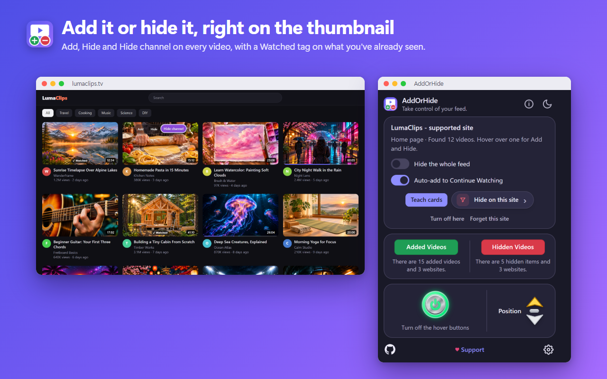
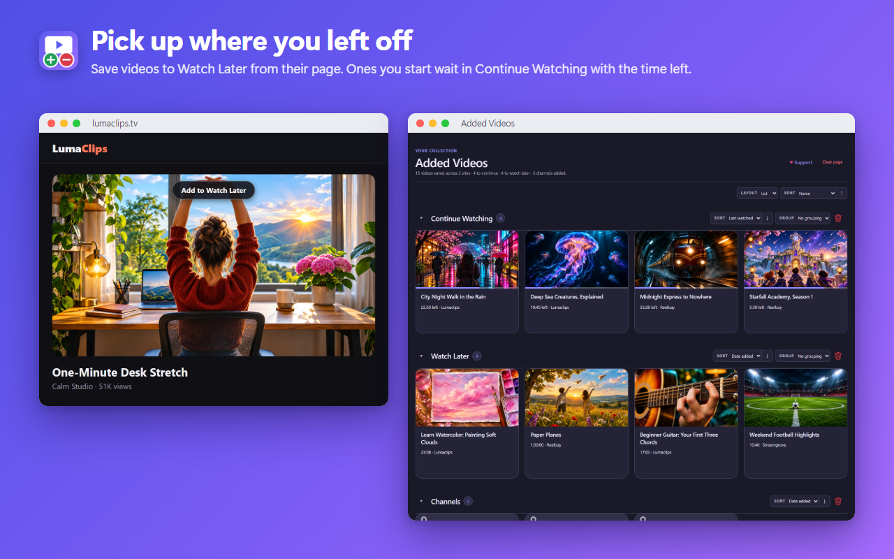
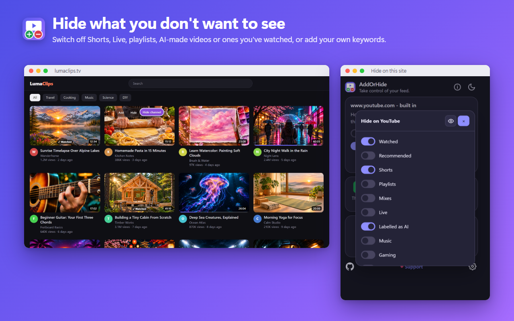
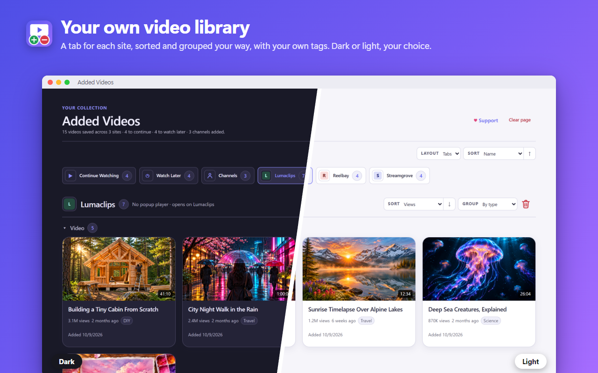
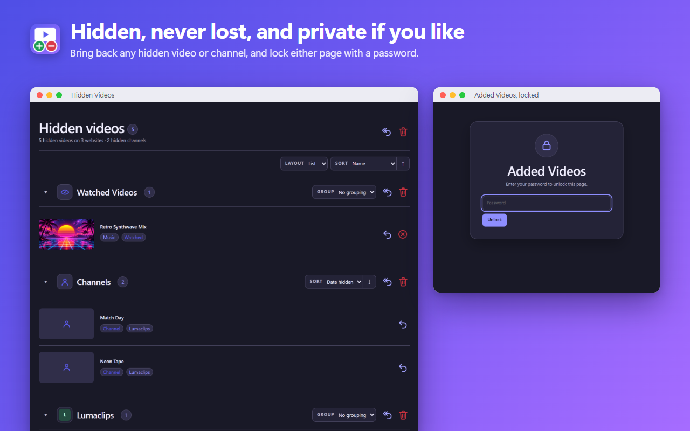

# AddOrHide

[](https://chromewebstore.google.com/detail/addorhide/ppohfbhkefnapejmompeeebiaipbbcef)
[](https://ko-fi.com/ashmustafa)

AddOrHide is a Chrome/Brave extension that puts you in charge of the videos on the sites you use. Point at any
thumbnail and choose **Add** (keep it on your own Added Videos page) or **Hide** (remove it from the feed for good),
hide whole categories and channels, save videos for later, see at a glance what you have already watched, and resume
any video where you left off. It has built-in rules for YouTube and Tubi (tubitv.com), one-click support for many
movie and streaming sites, and a card picker that teaches it any other video site. Everything stays in your browser.



| | |
|---|---|
|  |  |
|  |  |

## What's new in 1.1.16

- **No Watched tab on Hidden Videos opened from a private window, for real this time:** extension pages cannot run inside a private window, so Hidden Videos opens as an ordinary window and could not tell where it came from. It is now opened with `#private` when you click it in a private window, and leaves the Watched list out; reopening it from the other kind of window switches it over.

## What's new in 1.1.15

- **No Watched tab in private windows:** Hidden Videos now leaves watched videos out of a private window, as Added Videos already does with Continue Watching and Watch Later: no Watched tab or section, and they are not counted or touched by Restore all / Remove all there.

## What's new in 1.1.14

- **People get real facts, not film genres:** a saved actor or director shows their other jobs, age (or birth and death years) and place of birth, taken from the page's own details. Pages that describe a person no longer lend them genres from one of their films (Plex showed "Action(", "on-demand" and "category"); cards already saved repair themselves once.
- **Genre lists written as links** ("[Action](/category/action)") are read as plain genre names.
- **Tabs stay where you click them:** with the Added or Hidden Videos page open in a normal and a private window at once, the private page no longer saves its fallback tab, which made the normal page jump from Continue Watching or Watch Later to the first site.

## What's new in 1.1.13

- **No Hide channel on a channel's own page:** there every video is that channel's, and YouTube's cards carry no channel link (the slot can hold a view count), so Hide channel would hide a bogus "channel". Add and Hide stay; channels you hid never hide videos on a channel page you opened.

## What's new in 1.1.12

- **Page names in the popup:** directory, chart, trailer, trending and popular listings (Twitch's directory, IMDb's charts) are named Browse page instead of Other page.
- **Store text and privacy policy brought up to date** after a full pre-submission test: the policy now covers the AI-label checks on YouTube, the page lock and private windows.

## What's new in 1.1.11

- **Pictures right away in private windows:** a video you add or hide in a private window is read from its own page straight away, so its name, picture and details show on the Added and Hidden pages without opening it first. Reading other saved videos in the background stays off in private windows.
- **No Watched switch in private windows:** Hide on this site leaves out Watched there, since nothing is tracked; the setting made in a normal window is kept, and Hide/Unhide all types only changes the switches shown.

## What's new in 1.1.10

- **Episodes keep their number and picture:** on sites whose episode pages also describe the whole series (Cartoony), a saved episode is no longer renamed to the show or given the series banner. It gets "Show – Episode" with its own thumbnail and the show's year, and titles that already lost their episode number get it back the next time the page is read.

## What's new in 1.1.9

- **Steady buttons on Prime Video:** pointing at Add or Hide on a movie or TV card no longer makes Prime's hover preview close and reopen, which made the buttons flicker. Moving off the card still closes the preview. This also covers other sites whose cards grow into a hover preview.

## What's new in 1.1.8

- **Private windows stay private:** Continue Watching and Watch Later are left out of the Added Videos page and the popup's count there, the Auto-add to Continue Watching switch is hidden, and the player shows no Add to Watch Later button. Nothing is recorded or resumed in a private window, not even videos saved to Watch Later.

## What's new in 1.1.7

- **Smarter AI hiding on YouTube:** "Labelled as AI" now hides only videos that show AI-made content (AI short films, music videos, animations, Sora/Veo clip compilations) and keeps videos about AI: tutorials, reviews, comparisons, news, podcasts, interviews, courses and tool or prompt guides, even when YouTube labels them "Made with AI" or the channel mostly posts AI clips. A tool name alone ("Sora 2") no longer counts, and only creator tags that describe the result (#aivideo, #aianimation...) do. Earlier answers are rechecked under the new rules.

## What's new in 1.1.6

- **Only on Prime Video pages of amazon.com:** shopping pages, checkout and the rest of Amazon are left alone (no buttons, no hiding, no tracking), and the popup says "AddOrHide can't run on this page". Prime titles opened from a shopping link still work. Amazon shopping pages that earlier versions recorded as watched are cleared out.
- **Knows what page you're on:** the popup's status line names it (Home page, Browse page, Search results, Title page, Video player, Person page, Channel page, Your library).
- **No tracking on listing pages:** trailers that autoplay on Prime's home, browse and search pages, and on any site's home or search page, no longer land in Continue Watching.

## What's new in 1.1.5

- **Collapsible groups:** click a group heading (By site, By type...) in Continue Watching, Watch Later, Watched, Channels or any site section to fold its videos away; the page remembers which ones you folded.
- **Shorts are tracked:** YouTube Shorts now count towards Watched at any length (the Shorts player is narrow, so it was being skipped), and they never go to Continue Watching.
- **Continue Watching sooner:** a video joins Continue Watching after 10 seconds of playback instead of a minute.

## What's new in 1.1.4

- **Clear Sort and Group controls:** each is a small labelled pill ("SORT Last watched ↓", "GROUP By site"), with the order arrow inside the Sort pill; the page-wide control is now "Layout: List / Tabs".
- **Sort by size:** "Most videos" orders a page's sites by how many videos each holds; "Videos per site" does the same for the site groups inside Continue Watching, Watch Later, Watched and Channels while they are grouped by site.
- **Site logos** on "By site" group headings; Watched Videos can now be grouped by site.
- **Tabs follow the sort:** with many sites, the ones that sort last move behind More sites, so the order runs straight on.
- **Tidier:** no Site sort in Continue Watching and Watch Later (grouping by site does that job); dropdown items are readable in dark mode.

## What's new in 1.1.3

- **Hide AI videos on YouTube** ("Labelled as AI" under Hide by type): catches videos whose title says so ("AI Generated", "[AI Music Video]", "Sora 2", #aivideo...) straight away, and checks the rest quietly in the background, one video page every 2 seconds, for YouTube's own "Made with AI" label or AI tags and hashtags from the creator. A channel with three AI videos is hidden as a whole. Checking pauses for 30 minutes if YouTube shows its unusual-traffic page.
- **Hidden Videos page tabs and sorting:** group the page into tabs and sort its sections by name or most recently hidden, like the Added page; Watched Videos always comes first.
- **Password lock:** lock the Added Videos and Hidden Videos pages (each on its own) with one password set in Options. A locked page asks once per tab; turning a lock off, changing the password and exporting your data all need the current password. The popup buttons show a padlock while their page is locked.
- **Fixes:** Vimeo's hover buttons no longer sit behind the preview image; the Gaming filter now uses its whole list of game names (only the first 10 were checked).

## What's new in 1.1.2

- **Details fill in by themselves:** the Added page reads a saved title's own page for a missing year, genres, type, rating and poster, including Spanish pages like ViX (common genre names are translated to English).
- **Movies and shows show their year** (2026), not "7 months ago".
- **Grouping** options appear as soon as any saved video has that detail.
- **Genre** type for genre tiles (Shout TV), grouped as Genres.
- **Fixes:** Dailymotion thumbnails no longer disappear; Tubi's hover buttons stay centred on carousel cards; hiding a card on PBS, Crunchyroll and Kick leaves no gap; Kick videos keep their titles (not "true") and show under Kick as Live; on Pluto TV, hiding one live channel no longer hides its whole row; no scrollbar in the popup when Teach cards shows.
- **Look:** a round power button with a neon ring (green on, red off) around a raised metal disc, and a silver Position pill.

## What's new in 1.1.1

- **Group headings in Title Case** on the Added and Hidden pages ("TV Shows", "This Week", "Science Fiction and Fantasy"), and role groups pluralise properly ("Directors of Photography").
- **Power button:** a metallic rhombus whose thick outline and power sign turn green when on and red when off.

## What's new in 1.1.0

- **Watched:** a video counts as watched after about 90% real playback, not by opening it or skipping to the end. Tag it on every thumbnail and on its own page, or hide it automatically, and untag any video.
  - **How it is measured:** each video is split into 100 equal slices. A slice counts once about 70% of it has really played, and the video is watched when 90 slices count, so skipping an intro and the credits is fine. Seeking, playing faster than 2× and replaying the same part add nothing. Progress adds up across sessions.
  - **On YouTube:** a red progress bar at least 90% full under a thumbnail also counts, which covers videos watched before installing or on another device.
  - **Not tracked:** videos under 20 seconds (YouTube Shorts are tracked at any length), and anything played in a private window.
  - **Watched on or off:** with Watched on for a site, watched videos are hidden and listed under Hidden Videos > Watched. With it off, they stay in the feed with a Watched tag. Remove Watched clears the mark until the video is played to 90% again.
- **Watch Later:** hover over the player on a video's own page and choose Add to Watch Later. The list sits under Continue Watching, and a saved video moves there once you have played a few seconds.
- **Continue Watching:** videos you start appear with a progress bar and time left, and resume where you stopped, with Start over.
- **Hide by type, keyword and channel:** per-site categories such as Shorts, Playlists and Live, your own keywords, whole channels, and rows by name on streaming sites and any site where you taught cards. Find all rows also reads the site's genre pages.
- **Channels, playlists and categories:** Add works out what a card leads to. A channel goes to its own Channels list under Watch Later. A playlist, a mix or a category (such as one on Twitch's Browse page) is saved and hidden like any card, under its website with the type Playlist or Category; and a card with both an info link and a play link saves the one that plays. On The Roku Channel, By type then splits Movies from TV shows.
- **Added Videos:** tabs for Continue Watching, Watch Later, Channels and each website (a long list of sites moves behind a searchable More sites tab), website sorting, and grouping by channel, date added, decade or rating.
- **Hidden Videos:** the same sorting and grouping, a Show all button on every group, and channels and watched videos in their own groups.
- **Popup:** a redrawn power button (green on, red off), new position arrows and an Auto-add switch.
- **Privacy:** nothing is recorded in private windows (Continue Watching and Watch Later are hidden there), nor when the watch features are off except for videos you saved to Watch Later yourself, and Clear watch history wipes it in one click.

## Install

- **Chrome Web Store:** search for [AddOrHide](https://chromewebstore.google.com/search/AddOrHide) (works in Chrome,
  Brave and Edge).
- **From this repository (Developer mode):** download it (**Code → Download ZIP**, then extract) or `git clone` it,
  open `chrome://extensions` (Brave: `brave://extensions`), turn on **Developer mode**, choose **Load unpacked** and
  select the folder that contains `manifest.json`. Keep that folder; the browser runs the extension from it. To
  update, replace the files and click the extension's reload arrow.

Moving between the store copy and a Developer-mode copy: they are separate extensions with separate data, so use
**Options → Your data → Export** in one and **Import** in the other.

## Supported sites

YouTube (home feed, subscriptions and creators' Home/Videos/Shorts/Live tabs) and Tubi are built in. IMDb charts/lists, TMDB lists, Dailymotion home, explore, video pages and search, Twitch, Xumo Play, Pluto TV, The Roku Channel, Prime Video, Fandango at Home, Crunchyroll, Odysee, Kick, Rumble, PBS, ViX, Shout! TV, JustWatch, Rotten Tomatoes and Letterboxd can be enabled in one click with **Enable on this site**. Any other site can use the card picker. Prime Video was checked on its signed-out storefront; rows that appear only when signed in may need Rows by name. Sites that need a login or show a CAPTCHA or consent wall were not checked and should use the picker.

Xumo Play filters its fixed rows (Most Popular, tributes and seasonal rows, Originals, Exclusives, Recently Added, Recommended and Editor’s Picks) and has a Genres panel for individual row names. Pluto TV, Tubi, The Roku Channel, Fandango at Home, Crunchyroll, Twitch, Rumble, Kick, Odysee, PBS, ViX and Shout! TV also offer **Rows by name** for genre, collection and channel-pick shelves; row lists fill as the page loads, and **Find all rows** scrolls once to collect lazy-loaded rows. On those sites **Foreign titles, anywhere** hides foreign-language titles in any row (not just foreign rows); to hide one row only, use Rows by name. Other ready-made type filters include Pluto movies/TV/live/kids/mature; Roku movies/TV/kids/mature; Prime Video movies, TV, live, not in your plan, the banner and featured carousels, and Free with ads rows; Fandango free or paid; Crunchyroll series, movies, dubbed and subtitled; Odysee live and short videos; Kick gambling, chatting and gaming; Rumble live, Shorts and videos; Shout! live/VOD/sign-in; JustWatch and Rotten Tomatoes movies/TV (plus Rotten scores); and Letterboxd adult-themed films. PBS provides Rows by name where its captured cards did not expose a reliable type.

The Add/Hide buttons appear centred at the top of a card (or at the bottom of its video picture, chosen with the up/down arrowhead buttons under **Position** in the popup or Options) whenever the mouse is anywhere over it. The round power button turns them off and on for every site without un-hiding anything: its ring is green while the hover buttons show and red while they are off; its tooltip and the line under it say which. While they are off the toolbar icon turns grey with an OFF badge. If the site's own controls sit there, the buttons slide past them; if a site lays its own hover preview over the card (YouTube), the buttons are drawn above it.

## Look and feel

AddOrHide uses a calm indigo-and-violet interface with warm neutrals, clear controls, and small motion cues that make feed control feel approachable. It supports light and dark system themes and respects reduced-motion preferences.

The sun/moon switch in the popup header picks a light or dark theme for all AddOrHide pages (the default follows the system), and the popup's troubleshooting Details line is folded away until needed.

## Using it

On a recommendation card, **Hide** removes the video from the feed and provides a six-second Undo. **Add** saves the video while leaving it in the feed; clicking **Added** removes it from the Added list. The popup has two buttons side by side: green **Added Videos** opens your Added Videos page and red **Hidden Videos** opens the Hidden videos window. Each is greyed out while its list is empty and has a count line under it ("There are 3 added videos and 2 websites."). The Hidden videos window is grouped by website with collapsible sections, icon buttons per video (back-arrow **Restore**, ✕ **Remove**), a double back-arrow (**Restore all**) and a bin (**Remove all**) for everything, and a bin button on each website that removes that site's videos from the list (they stay hidden); its lid opens with a "?" next to it to ask first. Each website, Watched Videos and Channels can sort and group with only choices that change that section, and each has **Show all** to restore just its videos or channels.

The **Added Videos** page contains only videos explicitly added. It groups entries by website with favicon logo tiles (no brand logos are bundled), and each site shows only the sort and group options that would change something for its videos (including date added, title and channel; by type, genre, channel, date added, decade or rating when available). A separate **Continue Watching** section can sort or group resumable videos. The page toolbar can arrange website sections by name or recently added and switch between stacked sections and tabs (Continue Watching remains first). Groups follow the chosen sort, and the page keeps its scroll position when you sort, group, collapse or tag. The inline **Tag** editor lets you add or correct a type and comma-separated genres for sites that do not expose those details. Each website also has a bin button that deletes all of that site's videos from the page; its lid opens with a "?" next to it to ask first, each video's tag icon sets its type and genres, its ✕ removes it, and **Clear page** empties the whole page (greyed out, with a tooltip saying why, while there is nothing to clear). Every icon button has a short tooltip. The picker can learn up to twelve cumulative card patterns per site (**Teach cards** / **Teach more cards**).

**Where the data comes from:** duration, views, age, year, rating and genres are read from the card when you click **Add** (YouTube: duration, views and age; Tubi: duration, year, rating and genres; other sites are best effort). Nothing is fetched from the sites. Older entries and many sites will lack fields, and missing values always sort last.

On a catalog-supported site, choose **Enable on this site** and AddOrHide uses its built-in card rule. On any other site, choose **Enable on this site**, then choose a video or card in the page picker and press **Save**. AddOrHide learns a CSS pattern and adds **Hide** and **Add** buttons to similar cards. Card detection is heuristic, so a picker can fail on some sites; try a different part of the card. The site permission is requested only for the site you enable and can be revoked with **Disable**. AddOrHide never touches DRM or streaming playback.
The browser may close the popup when it asks for permission; AddOrHide finishes picker setup in the background only for sites that need it.

## Popup player

Supported videos can be played in a floating popup window using the site's official embed player. The player window is reused for later videos in the same normal or private browsing mode.

| Site | Popup player supports | Other saved entries |
| --- | --- | --- |
| YouTube | Videos and Shorts | — |
| Twitch | Live channels, videos and clips | — |
| IMDb | Video pages, including trailers | Title pages open on IMDb |
| Tubi, Dailymotion, TMDB | — | Open on the original site |

In private windows, the Added Videos page uses the hosted view at `youtube.com/robots.txt#addorhide-added`, because browsers do not open extension pages there. Turn on **Allow in Incognito** for AddOrHide. The popup and options page keep new tabs in the current window.

Storage is local to this browser and is not synced between devices. Added items are capped at 500 and hidden items at 1000, with the oldest entries evicted first. **Hide the whole feed** toggles for YouTube and Tubi are in Options (and in the popup for the current site) and are reversible from the same toggle.

## Hide by type and keyword

Each supported site has optional per-site filters in the popup and Options page. Choose categories such as YouTube Shorts, live streams, playlists, movies or Tubi TV shows, or enter comma-separated words and phrases. A word matches whole words (including non-English text) in the title, channel and available card tags; outside YouTube it also checks the card's visible or hidden text and labelled image/ARIA/title fields. Pluto's embedded page data also makes listed actor names, genres and descriptions searchable, so an actor name works as a keyword there.

Those filter controls also let you leave **featured carousels** alone: turn off “Include featured carousels” to keep the unusually large rotating rows (such as Tubi’s For You) visible while the same type and word filters continue to apply to ordinary rows. Directly hidden videos, hidden channels and watched videos are still hidden there.

Tubi, Pluto TV and The Roku Channel offer **Unsafe for children**. It filters cards rated PG-13, TV-14, R, NC-17, TV-MA, X, 16+/18+, or unrated, using card ratings and Pluto's page data where available. Tubi, Pluto TV and The Roku Channel also offer **Mature only**, the stricter R/NC-17/TV-MA/X/18+ set. Filtered cards disappear only from the current page: they are not added to Hidden Videos, and turning a category off or removing a word brings them back on the next page update.

Tubi, Pluto TV, Xumo Play, The Roku Channel, Fandango at Home, Crunchyroll, ViX and Shout! TV can also hide **Not in English** and **Dubbed** versions. **Not in English** keeps English-dubbed versions while still matching Spanish dubs and subtitled titles. Their **Recommended** filter hides recommendation rows; on Tubi it also catches “For You In …” feature cards.

On YouTube, Twitch, Odysee, Kick and Rumble, you can hide every video from a channel directly from a card. Supported sites can also hide watched videos after at least 90% real playback (or a 90% YouTube progress bar); progress is stored locally only. The Watching switch controls whether videos you start are auto-added to **Continue Watching**; it tracks only actual video pages, not home-page previews. Watched thumbnails are labelled across feeds, search, sidebars and channel pages. Watched videos are saved in **Hidden Videos** so they remain hidden until restored; restored watched videos are remembered so the switch does not immediately hide them again. The Hidden Videos window keeps hidden **Channels** and **Watched Videos** in their own sections.

## Support link

An optional Ko-fi tip link (`HOA.SUPPORT_URL`, https://ko-fi.com/ashmustafa) appears as a quiet "♥ Support" text link in the centre of the popup footer (between a GitHub icon linking here and Options), the Options page header and the Added Videos page header. It only opens the Ko-fi page; no feature depends on it and nothing is sent to Ko-fi.

## Permissions

- `storage` saves hidden videos, Added videos, and learned site rules locally.
- `scripting` registers and injects the picker and learned site rules.
- `activeTab` permits the popup to start the picker in the tab the user selected.
- Optional `http://*/*` and `https://*/*` host permissions are requested one site at a time when you choose **Enable on this site**. YouTube, Tubi and the YouTube thumbnail host are included as built-in permissions.

## Testing

Run the shared pure-function tests with:

```text
node tests/shared.test.js
node tests/sites.test.js
node tests/picker.test.js
node tests/catalog.test.js
JSDOM_PATH=<folder>/node_modules/jsdom node tests/engine.test.js
```

Regenerating icons: run `python tools/make_icons.py` from this directory.

Build the Chrome Web Store archive with `python tools/package.py .`. It writes the runtime-only archive to `dist/AddOrHide-<version>.zip`.

## Status: 1.1.4

1.1.16 is the next Chrome Web Store update; 1.1.13 is the version live in the store (see the *What's new* sections above). Up to 1.0.13: YouTube search results, Shorts and new layouts everywhere, gap-free
hiding of Shorts, Hide the whole feed on every YouTube page, two installed copies no longer fight (the newest runs
the page and the other one's popup says so), a redesigned popup (Added Videos and Hidden Videos side by side, a round
3D power button, arrowhead Position buttons, a GitHub link) and a per-website delete button on the Added page and in
the Hidden videos window.

Used day to day as an unpacked extension in Brave on YouTube (home feed and creator pages), Tubi, IMDb, Twitch and Dailymotion, including private windows.

Checked in a real browser (Brave with Playwright, see below) on live pages, plus the YouTube watch-page sidebar on a styled copy of its markup: recommendation rows on detail pages (Tubi "You may also like", TMDB Recommendations, Dailymotion and IMDb suggestions), Enable on this site, Add/Hide/Undo on YouTube creator pages, Tubi, IMDb (home, charts, title, trailers, search, video gallery), Twitch and Dailymotion; the card picker on PBS and Twitch; button placement and hover visibility, including a layer covering the card; the Added page sorting, grouping and scroll position; the popup's page Details line.

Not checked by automation: the browser's own permission prompt (it cannot be clicked by automation), the signed-in YouTube home feed and its inline preview player (checked by hand only), and the private-window Added page on `youtube.com/robots.txt`.

The popup shows a **Details** line (page script version, cards found, buttons attached). It is the first thing to read when buttons do not appear on a page.

## Privacy

AddOrHide collects nothing and sends nothing anywhere: your Added and Hidden lists, site rules and settings are kept in
the browser's local extension storage. The full policy is at
https://novadreamer.github.io/addorhide-player/privacy.html (source: `store/privacy-policy.md`). Questions or problem
reports: mybrainnoor@gmail.com, or open an issue here.

## Legal

Copyright © 2026 Ashraf Mustafa. Free for personal use; you may not sell, redistribute or republish it without
written permission. See [LICENSE](LICENSE) and [LEGAL.md](LEGAL.md) (no warranty, not affiliated with any site it works
on, donations).

## Store submission

Drafts for the Chrome Web Store live in `store/`: `privacy-policy.md` (and a ready-to-host `privacy-policy.html` generated from it) and `store-listing.md` (listing text, permission justifications, data disclosures, reviewer test steps, checklist). The policy is hosted at https://novadreamer.github.io/addorhide-player/privacy.html.

## Export and import

The Options page's **Your data** section can export added videos, hidden videos, site rules and Added page preferences as a local JSON backup. **Import data** merges those items with the current browser data; newer entries win, existing data is not deleted, and site permissions are never included.

## Testing against real site markup

`tests/fixtures/*.html` hold three real cards each, captured from the live YouTube, Tubi, IMDb, TMDB, Dailymotion and Twitch pages and trimmed. `tests/engine.test.js` runs the real `shared.js`, `catalog.js` and `content.js` against them in jsdom (buttons on every card, Add and Hide data, Undo, hidden-stays-hidden, the wrapper that gets hidden). jsdom is not bundled: run `npm install jsdom` in any folder and start the test with `JSDOM_PATH=<that folder>/node_modules/jsdom node tests/engine.test.js`. Without it the test prints SKIPPED. When a site changes its markup, recapture its fixture and the test will show what broke. jsdom has no layout, so button placement and hover visibility are not covered by it.

## Real-browser tests

`tools/e2e-browser.js`, `tools/e2e-permission.js` and `tools/e2e-v09.js` load the unpacked extension into an installed Brave/Chrome/Edge with Playwright (`npm install playwright-core`, then set `PLAYWRIGHT_PATH` and `BROWSER_EXE`; see the header of each file). The permission test is the one that would have caught the "Only permissions specified in the manifest may be requested" failure that stopped **Enable on this site** from working in 0.8.0: unit tests that stub the permissions API cannot see that error, only a real browser can. The popup also shows how many videos AddOrHide recognised on the current page, so a rule that does not match a page type is visible instead of silent.
